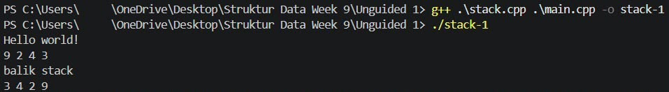
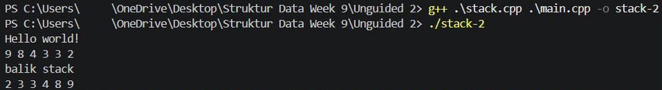
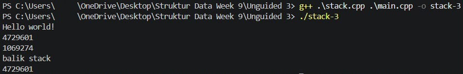

# <h1 align="center">Laporan Praktikum Modul 7 - STACK</h1>
<p align="center">Arvin Ihsan Fatih - 109082500050</p>

## Dasar Teori
Stack atau tumpukan adalah struktur data linear yang menyimpan elemen secara berurutan dengan mekanisme akses hanya melalui satu ujung yang disebut top. Prinsip operasi yang digunakan adalah LIFO (Last In, First Out), yang berarti data yang terakhir masuk akan menjadi data yang pertama keluar. Konsep ini menyerupai tumpukan benda dalam kehidupan sehari-hari seperti tumpukan buku atau piring. Pengelolaan data pada stack diatur melalui bagian atas saja, sehingga penambahan maupun penghapusan elemen dilakukan pada posisi yang sama[1].

### A. Karakteristik dan Konsep LIFO pada Stack<br/>
Penerapan aturan pengolahan data pada stack memiliki sifat yang khas dan terstruktur.
#### 1. Elemen terakhir yang dimasukkan ke dalam stack akan menjadi elemen pertama yang diambil kembali. Contoh prosesnya jika dimasukkan data A, B, lalu C, maka data yang keluar pertama kali adalah C.
#### 2. Operasi pada stack hanya dilakukan pada satu sisi saja yaitu top, memiliki struktur yang sederhana serta mudah diimplementasikan, dan umumnya digunakan untuk proses yang bersifat sementara.
#### 3. Stack dibentuk oleh komponen utama berupa Top sebagai penunjuk elemen teratas dan Elemen sebagai data yang disimpan di dalamnya[1].

### B. Operasi Dasar dan Representasi Memori Stack<br/>
Pengelolaan data di dalam stack didukung oleh beberapa fungsi primitif serta metode penyimpanan yang fleksibel.
#### 1. Operasi push digunakan untuk menambahkan elemen baru ke bagian atas stack dengan kompleksitas waktu $O(1)$. Operasi pop berfungsi untuk menghapus elemen paling atas, sedangkan peek digunakan untuk melihat elemen teratas tanpa menghapusnya. Selain itu, terdapat fungsi pemeriksaan kondisi seperti IsEmpty dan IsFull.
#### 2. Stack berbasis array menawarkan ukuran tetap dengan implementasi yang sederhana serta akses data yang cepat, namun memiliki kapasitas yang terbatas dan risiko overflow.
#### 3. Stack berbasis linked list bersifat dinamis dengan ukuran yang fleksibel dan tidak memiliki batasan kapasitas yang kaku, meskipun memerlukan alokasi memori tambahan dan implementasi yang sedikit lebih kompleks[1].

## Guided 

### 1. stack.h

```C++
/* file : stack.h
   contoh ADT stack dengan representasi tabel */
#ifndef STACK_H_INCLUDED
#define STACK_H_INCLUDED

#include <iostream>
using namespace std;

struct infotype {
    char nim[20];
    char nama[20];
};
struct Stack {
    infotype info[10];
    int Top;
};

/* prototype */
/******** pengecekan apakah Stack kosong *********/
int isEmpty(Stack S);
/* mengembalikan nilai 0 jika stack kosong */

/******** pembuatan Stack ********/
void createStack(Stack &S);
/* I.S. sembarang
   F.S. terbentuk stack dengan Top=0 */

/******** penambahan elemen pada Stack ********/
void push(Stack &S, infotype X);
/* I.S. Stack mungkin kosong
   F.S. menambahkan elemen pada stack dengan nilai X, TOP=TOP+1 */

/******** penghapusan elemen pada Stack ********/
void pop(Stack &S, infotype &X);
/* I.S. stack tidak kosong
   F.S. nilai info pada indeks TOP disimpan pada X, kemudian TOP=TOP-1 */

/******** proses semua elemen Stack *********/
void viewStack(Stack S);
/* I.S. stack mungkin kosong
   F.S. jika stack tidak kosong menampilkan semua info yang ada pada stack
*/
#endif // STACK_H_INCLUDED
```
Menggunakan array info berkapasitas 10 elemen untuk menyimpan data mahasiswa berupa nim dan nama, serta variabel Top untuk melacak posisi indeks teratas. Berisi deklarasi isEmpty (pengecekan kosong), createStack (inisialisasi Top = 0), push (penambahan elemen), pop (penghapusan elemen teratas), dan viewStack (menampilkan seluruh isi stack).

### 2. stack.cpp

```C++
#include "stack.h"

int isEmpty(Stack S) {
    /* Top = 0 berarti kosong, sesuai komentar di stack.h dikembalikan 0 */
    if (S.Top == 0) {
        return 0;
    } else {
        return 1;
    }
}

void createStack(Stack &S) {
    S.Top = 0;
}

void push(Stack &S, infotype X) {
    if (S.Top < 10) {
        S.Top = S.Top + 1;
        S.info[S.Top - 1] = X;   /* Top 1..10 dipetakan ke indeks array 0..9 */
    } else {
        cout << "Stack penuh, data tidak bisa ditambahkan" << endl;
    }
}

void pop(Stack &S, infotype &X) {
    if (isEmpty(S) != 0) {
        X = S.info[S.Top - 1];
        S.Top = S.Top - 1;
    } else {
        cout << "Stack kosong, tidak ada data yang bisa diambil" << endl;
    }
}

void viewStack(Stack S) {
    if (isEmpty(S) == 0) {
        cout << "Stack kosong" << endl;
    } else {
        cout << "Isi stack (dari TOP):" << endl;
        for (int i = S.Top; i >= 1; i--) {
            cout << i << ". " << S.info[i - 1].nim << " - "
                 << S.info[i - 1].nama << endl;
        }
    }
}
```
Berisi realisasi kode untuk isEmpty (cek stack kosong), createStack (inisialisasi Top = 0), push (menambah data jika belum penuh), pop (mengambil data teratas), dan viewStack (menampilkan seluruh isi dari posisi Top ke bawah).

### 3. main.cpp

```C++
#include <iostream>
#include <cstring>
#include "stack.h"
using namespace std;

int main() {
    Stack S;
    infotype data, hasil;

    createStack(S);
    cout << "Stack baru dibuat, Top = " << S.Top << endl;
    viewStack(S);

    cout << endl << "--- Push 3 data ---" << endl;
    strcpy(data.nim, "103112400001");
    strcpy(data.nama, "Andi");
    push(S, data);

    strcpy(data.nim, "103112400002");
    strcpy(data.nama, "Budi");
    push(S, data);

    strcpy(data.nim, "103112400003");
    strcpy(data.nama, "Citra");
    push(S, data);
    viewStack(S);

    cout << endl << "--- Pop 1 data ---" << endl;
    pop(S, hasil);
    cout << "Data yang diambil: " << hasil.nim << " - " << hasil.nama << endl;
    viewStack(S);

    cout << endl << "--- Pop sampai kosong ---" << endl;
    pop(S, hasil);
    pop(S, hasil);
    pop(S, hasil);
    viewStack(S);

    return 0;
}
```
Menguji pengoperasian stack berbasis tabel secara menyeluruh, mulai dari pembuatan stack (createStack), penambahan 3 data mahasiswa melalui prosedur push (Andi, Budi, Citra), pengambilan data teratas lewat prosedur pop, hingga pengosongan stack dan pemanggilan viewStack.

## Unguided 

### 1. Buatlah ADT Stack menggunakan ARRAY sebagai berikut di dalam file “stack.h”. Buatlah implementasi ADT Stack menggunakan Array pada file “stack.cpp” dan “main.cpp”.

### stack.h
```C++
#ifndef STACK_H_INCLUDED
#define STACK_H_INCLUDED

#include <iostream>

typedef int infotype;

struct Stack {
    infotype info[20];
    int top;
};

void createstack(Stack &S);
bool isEmpty(Stack S);
bool isFull(Stack S);
void push(Stack &S, infotype x);
infotype pop(Stack &S);
void printInfo(Stack S);
void balikStack(Stack &S);

#endif
```

### stack.cpp
```C++
#include "stack.h"

using namespace std;

void createstack(Stack &S) {
    S.top = 0;
}

bool isEmpty(Stack S) {
    return S.top == 0;
}

bool isFull(Stack S) {
    return S.top == 20;
}

void push(Stack &S, infotype x) {
    if (!isFull(S)) {
        S.top++;
        S.info[S.top - 1] = x;
    } else {
        cout << "Stack penuh!" << endl;
    }
}

infotype pop(Stack &S) {
    infotype x = -1;
    if (!isEmpty(S)) {
        x = S.info[S.top - 1];
        S.top--;
    } else {
        cout << "Stack kosong!" << endl;
    }
    return x;
}

void printInfo(Stack S) {
    if (!isEmpty(S)) {
        for (int i = S.top; i >= 1; i--) {
            cout << S.info[i - 1] << " ";
        }
        cout << endl;
    } else {
        cout << "Stack kosong" << endl;
    }
}

void balikStack(Stack &S) {
    if (!isEmpty(S)) {
        Stack temp1, temp2;
        createstack(temp1);
        createstack(temp2);

        while (!isEmpty(S)) {
            push(temp1, pop(S));
        }

        while (!isEmpty(temp1)) {
            push(temp2, pop(temp1));
        }

        while (!isEmpty(temp2)) {
            push(S, pop(temp2));
        }
    }
}
```

### main.cpp
```C++
#include <iostream>
#include "stack.h"

using namespace std;

int main() {
    Stack S;
    
    cout << "Hello world!" << endl;
    
    createstack(S);
    push(S, 3);
    push(S, 4);
    push(S, 8);
    pop(S);
    push(S, 2);
    push(S, 3);
    pop(S);
    push(S, 9);
    
    printInfo(S);
    
    balikStack(S);
    
    cout << "balik stack" << endl;
    printInfo(S);

    return 0;
}
```

### Output Unguided 1 :



Mengimplementasikan struktur data Stack berbasis array berkapasitas 20 elemen dengan operasi dasar (push, pop, printInfo) serta prosedur balikStack untuk membalikkan urutan elemen menggunakan stack bantu, menghasilkan urutan terbalik sesuai prinsip LIFO.

### 2. Tambahkan prosedur pushAscending( in/out S : Stack, in x : integer)

### stack.h
```C++
#ifndef STACK_H_INCLUDED
#define STACK_H_INCLUDED

#include <iostream>

typedef int infotype;

struct Stack {
    infotype info[20];
    int top;
};

void createstack(Stack &S);
bool isEmpty(Stack S);
bool isFull(Stack S);
void push(Stack &S, infotype x);
void pushAscending(Stack &S, infotype x);
infotype pop(Stack &S);
void printInfo(Stack S);
void balikStack(Stack &S);

#endif
```

### stack.cpp
```C++
#include "stack.h"

using namespace std;

void createstack(Stack &S) {
    S.top = 0;
}

bool isEmpty(Stack S) {
    return S.top == 0;
}

bool isFull(Stack S) {
    return S.top == 20;
}

void push(Stack &S, infotype x) {
    if (!isFull(S)) {
        S.top++;
        S.info[S.top - 1] = x;
    } else {
        cout << "Stack penuh!" << endl;
    }
}

void pushAscending(Stack &S, infotype x) {
    if (isFull(S)) {
        cout << "Stack penuh!" << endl;
        return;
    }
    
    Stack temp;
    createstack(temp);

    while (!isEmpty(S) && S.info[S.top - 1] > x) {
        push(temp, pop(S));
    }

    push(S, x);

    while (!isEmpty(temp)) {
        push(S, pop(temp));
    }
}

infotype pop(Stack &S) {
    infotype x = -1;
    if (!isEmpty(S)) {
        x = S.info[S.top - 1];
        S.top--;
    } else {
        cout << "Stack kosong!" << endl;
    }
    return x;
}

void printInfo(Stack S) {
    if (!isEmpty(S)) {
        for (int i = S.top; i >= 1; i--) {
            cout << S.info[i - 1] << " ";
        }
        cout << endl;
    } else {
        cout << "Stack kosong" << endl;
    }
}

void balikStack(Stack &S) {
    if (!isEmpty(S)) {
        Stack temp1, temp2;
        createstack(temp1);
        createstack(temp2);

        while (!isEmpty(S)) {
            push(temp1, pop(S));
        }
        while (!isEmpty(temp1)) {
            push(temp2, pop(temp1));
        }
        while (!isEmpty(temp2)) {
            push(S, pop(temp2));
        }
    }
}
```

### main.cpp
```C++
#include <iostream>
#include "stack.h"

using namespace std;

int main() {
    Stack S;
    
    cout << "Hello world!" << endl;
    
    createstack(S);
    pushAscending(S, 3);
    pushAscending(S, 4);
    pushAscending(S, 8);
    pushAscending(S, 2);
    pushAscending(S, 3);
    pushAscending(S, 9);
    
    printInfo(S);
    
    balikStack(S);
    
    cout << "balik stack" << endl;
    printInfo(S);

    return 0;
}
```

### Output Unguided 2 :



Menambahkan prosedur pushAscending untuk menyisipkan elemen secara terurut menaik (ascending) ke dalam stack dengan memanfaatkan stack temporer, sehingga posisi TOP selalu merepresentasikan nilai terbesar secara otomatis.

### 3. Tambahkan prosedur getInputStream( in/out S : Stack ). Prosedur akan terus membaca dan menerima input user dan memasukkan setiap input ke dalam stack hingga user menekan tombol enter. Contoh: gunakan cin.get() untuk mendapatkan inputan user.

### stack.h
```C++
#ifndef STACK_H_INCLUDED
#define STACK_H_INCLUDED

#include <iostream>

typedef char infotype;

struct Stack {
    infotype info[20];
    int top;
};

void createstack(Stack &S);
bool isEmpty(Stack S);
bool isFull(Stack S);
void push(Stack &S, infotype x);
infotype pop(Stack &S);
void printInfo(Stack S);
void balikStack(Stack &S);
void getInputstream(Stack &S);

#endif
```

### stack.cpp
```C++
#include "stack.h"

using namespace std;

void createstack(Stack &S) {
    S.top = 0;
}

bool isEmpty(Stack S) {
    return S.top == 0;
}

bool isFull(Stack S) {
    return S.top == 20;
}

void push(Stack &S, infotype x) {
    if (!isFull(S)) {
        S.top++;
        S.info[S.top - 1] = x;
    } else {
        cout << "Stack penuh!" << endl;
    }
}

infotype pop(Stack &S) {
    infotype x = -1;
    if (!isEmpty(S)) {
        x = S.info[S.top - 1];
        S.top--;
    } else {
        cout << "Stack kosong!" << endl;
    }
    return x;
}

void printInfo(Stack S) {
    if (!isEmpty(S)) {
        for (int i = S.top; i >= 1; i--) {
            cout << S.info[i - 1];
        }
        cout << endl;
    } else {
        cout << "Stack kosong" << endl;
    }
}

void balikStack(Stack &S) {
    if (!isEmpty(S)) {
        Stack temp1, temp2;
        createstack(temp1);
        createstack(temp2);

        while (!isEmpty(S)) {
            push(temp1, pop(S));
        }
        while (!isEmpty(temp1)) {
            push(temp2, pop(temp1));
        }
        while (!isEmpty(temp2)) {
            push(S, pop(temp2));
        }
    }
}

void getInputstream(Stack &S) {
    char c;
    while (cin.get(c) && c != '\n') {
        if (c != ' ') {
            push(S, c);
        }
    }
}
```

### main.cpp
```C++
#include <iostream>
#include "stack.h"

using namespace std;

int main() {
    Stack S;
    
    cout << "Hello world!" << endl;
    
    createstack(S);
    getInputstream(S);
    
    printInfo(S);
    
    balikStack(S);
    
    cout << "balik stack" << endl;
    printInfo(S);

    return 0;
}
```

### Output Unguided 3 :



Menambahkan prosedur getInputstream untuk membaca input karakter dari pengguna secara beruntun menggunakan cin.get() sampai tombol Enter (\n) ditekan, lalu memasukkannya ke dalam stack secara otomatis sesuai prinsip LIFO.

## Kesimpulan
Dari praktikum Modul 7 ini saya dapat memahami dan mengimplementasikan struktur data Stack yang bekerja berdasarkan prinsip LIFO (Last In, First Out), di mana elemen yang terakhir masuk akan menjadi yang pertama keluar melalui satu ujung penunjuk yaitu Top. Memahami seperti pembuatan stack, push, pop, penanganan kondisi dengan isEmpty dan isFull, hingga fungsi tambahan seperti pushAscending, pembalikan stack (balikStack), dan pembacaan aliran input (getInputstream).

## Referensi
[1] Diana, A. (2026). "Stack: Konsep LIFO dan Penerapannya dalam Dunia Nyata". Telkom University Jakarta. Diakses pada 12 November 2026 https://jakarta.telkomuniversity.ac.id/stack-konsep-lifo-dan-penerapannya-dalam-dunia-nyata/.